# Fansly AI DM Sales Engine (AI_DM_Sales) 大規模リファクタリング計画書 (TODO.md)

本ドキュメントは、ローカルLLM（`qwen3.8` / 64Kコンテキスト）が1チケットずつ迷わず安全に実装・テストできるよう、依存関係順に細分化した作業タスク一覧である。

---

## 📌 調査結果まとめ：主要ファイル構成と役割マップ

```
Fansly_Empire/
├── shared_assets/
│   ├── characters/              # キャラクター別アセット (Sylphy-Mia, queen_lilith など)
│   │   └── <char_id>/
│   │       ├── settings.json    # ボット稼働・価格・睡眠時間等のキャラ個別設定
│   │       ├── dm_persona.json  # 口調・一人称・ニックネーム・トーン等のペルソナ
│   │       ├── plans.json       # サブスクプラン定義
│   │       └── ppv_vault/       # PPV動画・画像、ぼかしプレビュー、原本
│   └── database/
│       └── empire_core.db       # 統合SQLite DB (WALモード)
└── AI_DM_Sales/
    ├── run_dm_sales.py          # サーバー起動エントリポイント、旧プロセス清掃、各ワーカー起動
    ├── run_dm_sales_起動.bat     # Windows起動バッチ（Chrome appモード起動＋Flaskバックグラウンド）
    ├── app/
    │   ├── core/
    │   │   ├── config.py        # パス設定、Ollama基本設定、危険キーワード
    │   │   ├── database.py      # SQLite接続（WAL）、テーブル初期化、各テーブルCRUD
    │   │   └── llm_client.py    # Ollama APIクライアント、翻訳、テキスト/JSON生成
    │   ├── services/
    │   │   ├── character_loader.py    # キャラ設定・PPVメタデータ読み書き
    │   │   ├── fansly_dm_bot.py       # PlaywrightによるFansly DM巡回、送受信、ウォッチドッグ
    │   │   ├── sales_engine.py        # 営業判定、S.E.L.L.フェーズ制御、PPV選定、プロンプト生成
    │   │   ├── profiler_service.py    # 顧客カルテ抽出・心理プロファイル分析
    │   │   ├── followup_worker.py     # 未読FOMOリマインド・Step 2追撃ワーカー
    │   │   ├── dormant_revival_worker.py # 休眠ファン掘り起こしバッチ（無効化対象）
    │   │   ├── optimizer_batch.py     # A/B自己進化ルール・プレイブック（無効化対象）
    │   │   └── media_blur_service.py  # PPVモザイク・ぼかしプレビュー画像生成
    │   ├── routes/
    │   │   ├── dashboard.py     # モニタリング画面・手動送信・ファン管理API
    │   │   └── vault_routes.py  # PPV素材一覧・アップロード・設定API
    │   └── templates/
    │       └── index.html       # 単一HTMLフロントエンド（タブ1〜4、設定モーダル）
    └── tests/                   # 各種テストスクリプト
```

---

## 🎯 コア設計思想と実装原則（全チケット共通厳守）

1. **決定論的制御**: 会話の口調・タグ分類・記憶の要約はLLMに任せるが、裏の営業ロジック・状態遷移・PPV選定・リソース制御は100% Pythonの決定論的コードで機械的に制御・可視化する。
2. **安全な無効化**: 廃止対象の機能（A/Bテスト、S.E.L.L.ポイント制、チップ誘導、休眠掘り起こし、Step 2追撃）はコードを破棄・削除するのではなく、**実行スキップ（フラグ分岐または早期リターン）** で安全に無効化し、既存のセッション管理や送受信の土台を壊さない。
3. **1チケット1〜2ファイル**: 各チケットで変更するファイルは原則1〜2ファイルに抑え、`qwen3.8` がコンテキスト溢れを起こさず自己完結できるようにする。
4. **巨大ファイルの局所編集ルール（厳守）**:
   - `index.html`（約4400行）、`fansly_dm_bot.py`（約3900行）、`sales_engine.py`（約2000行）、`database.py`（約2700行）などの巨大ファイルに対しては、**ファイル全体の読み込み（cat/全行read）およびファイル全体の全書き換え（上書き保存）を固く禁止する**。
   - 対象となる関数・クラス・セレクタ・HTML要素のIDの前後の行番号や特徴的文字列をピンポイントで検索・参照し、該当ブロックのみを部分編集（差分置換 / edit_file等）すること。これによりコンテキスト溢れによる意図しないコード欠損・デグレを物理的に防止する。
5. **省略禁止**: 実装内容の関数名・SQL文・JSONスキーマ・条件分岐を完全に書き切り、`...` による省略は行わない。

---

## 🗺️ 全体実装ロードマップ（依存関係順）

```mermaid
flowchart TD
    subgraph Phase1["Phase 1: DBスキーマ・マスター設定・インフラ基盤"]
        T11["Ticket 1.1: master_tags.json 新規作成"]
        T12["Ticket 1.2: SQLite DBマイグレーション (PRAGMA確認付き)"]
        T13["Ticket 1.3: Discord通知モジュール作成"]
        T14["Ticket 1.4: 異常終了時自動再起動ラッパー"]
        T11 --> T12
        T12 --> T13
        T13 --> T14
    end

    subgraph Phase2["Phase 2: LLMクライアント・優先度キュー・不屈リトライ"]
        T21["Ticket 2.1: Ollama優先度キューとVRAM即解放"]
        T22["Ticket 2.2: 不屈のリトライと滞留通知"]
        T14 --> T21
        T21 --> T22
    end

    subgraph Phase3["Phase 3: 通信・死活監視・排他制御・連投デバウンス"]
        T31["Ticket 3.1: 送信中排他ロック is_sending"]
        T32["Ticket 3.2: ゾンビ検知3段階リカバリ"]
        T33["Ticket 3.3: 受信連投デバウンス処理"]
        T34["Ticket 3.4: 手動介入時のステート同期"]
        T22 --> T31
        T31 --> T32
        T32 --> T33
        T33 --> T34
    end

    subgraph Phase4["Phase 4: 営業ロジック・ステートマシン・PPV選定"]
        T41["Ticket 4.1: ブラックボックス機能＋Step2追撃の安全無効化"]
        T42["Ticket 4.2: マスタータグ検索・未購入7日間除外PPV選定"]
        T43["Ticket 4.3: 耳役LLM (タグ分類・意図検知・NEED抽出)"]
        T44["Ticket 4.4: 構造化長期記憶 (facts / summary)"]
        T45["Ticket 4.5: 新ステートマシン (3段階＋救済・例外)"]
        T46["Ticket 4.6: PPV登録Vision廃止とチップ選択"]
        T34 --> T41
        T41 --> T42
        T42 --> T43
        T43 --> T44
        T44 --> T45
        T45 --> T46
    end

    subgraph Phase5["Phase 5: バックエンドAPIエンドポイント拡充"]
        T51["Ticket 5.1: マスタータグ・NEEDリストAPI"]
        T52["Ticket 5.2: PPV武器庫更新API"]
        T53["Ticket 5.3: システム設定・Discord設定API"]
        T54["Ticket 5.4: モニタリング詳細API"]
        T46 --> T51
        T51 --> T52
        T52 --> T53
        T53 --> T54
    end

    subgraph Phase6["Phase 6: フロントエンドUI改修"]
        T61["Ticket 6.1: [⚙️ 設定] モーダル改修"]
        T62["Ticket 6.2: タブ2 PPVタグチップUI"]
        T63["Ticket 6.3: タブ2 NEEDリスト表示・昇格UI"]
        T64["Ticket 6.4: タブ1 ステートマシン可視化UI"]
        T65["Ticket 6.5: 不要UIの非表示化・整理"]
        T54 --> T61
        T61 --> T62
        T62 --> T63
        T63 --> T64
        T64 --> T65
    end

    subgraph Phase7["Phase 7: 統合テスト・シミュレーター検証"]
        T71["Ticket 7.1: パイプライン単体・統合テスト"]
        T72["Ticket 7.2: 営業シミュレーター総合確認"]
        T65 --> T71
        T71 --> T72
    end
```



---

## 📝 実装タスク詳細チケット一覧

### Phase 1: DBスキーマ・マスター設定・インフラ基盤

#### Ticket 1.1: カテゴリ別マスタータグ定義ファイルの作成 `[x] 完了`
- **対象ファイル**: `C:\Fansly_Empire\shared_assets\master_tags.json`（新規作成）
- **具体的な実装内容**:
  1. `shared_assets/master_tags.json` を新規作成する。
  2. 以下の3カテゴリ構造で初期マスタータグを定義する:
     - `play` (プレイ・属性): `bdsm`, `worship`, `gfe`, `femdom`, `submissive`, `dirty_talk`, `humiliation`, `teasing`
     - `body_outfit` (パーツ・衣装): `lingerie`, `cosplay`, `bikini`, `stockings`, `feet`, `bunny`, `latex`, `glasses`, `maid`
     - `situation` (シチュエーション): `bedroom`, `shower_bath`, `outdoor`, `hotel`, `car`, `morning`, `late_night`, `pov`
  3. 各タグ要素は以下のスキーマを持つこと:
     ```json
     {
       "id": "lingerie",
       "category": "body_outfit",
       "name_ja": "ランジェリー・下着",
       "llm_hint": "lingerie, bra, panties, lace underwear, undergarments, sexy underwear"
     }
     ```
  4. ファイル読み込み時のヘルパー関数として、カテゴリ別グループ取得およびID存在判定を行える標準JSON構造にする。
- **完了条件**:
  - `master_tags.json` が有効なJSONとして保存され、Pythonの `json.load()` でエラーなく読み込めること。3カテゴリそれぞれに最低6個以上の初期タグが登録されていること。

---

#### Ticket 1.2: SQLite DBマイグレーション（テーブル拡張・新規テーブル追加・PRAGMA安全性確保） `[x] 完了`
- **対象ファイル**: `C:\Fansly_Empire\AI_DM_Sales\app\core\database.py`（※局所編集ルール厳守: `init_db()` 付近のみを編集）
- **具体的な実装内容**:
  1. `init_db()` 関数内に、既存テーブルのマイグレーションと新規テーブル作成を追加する。
     **【重要：安全な実行仕様】** すべての `ALTER TABLE ... ADD COLUMN` は、事前に必ず `PRAGMA table_info(<テーブル名>)` を実行して既存カラム名の一覧を取得し、カラムが存在しないことを確認した上で実行すること（二重追加エラーの防止）。
     - **`fans` テーブル**:
       ```python
       fan_cols = {str(r["name"]) for r in cur.execute("PRAGMA table_info(fans);").fetchall()}
       if "state_step_turns" not in fan_cols:
           cur.execute("ALTER TABLE fans ADD COLUMN state_step_turns INTEGER DEFAULT 0;")
       if "last_pitch_at" not in fan_cols:
           cur.execute("ALTER TABLE fans ADD COLUMN last_pitch_at TEXT;")
       ```
     - **`ppv_vault` テーブル**:
       ```python
       pv_cols = {str(r["name"]) for r in cur.execute("PRAGMA table_info(ppv_vault);").fetchall()}
       if "is_general" not in pv_cols:
           cur.execute("ALTER TABLE ppv_vault ADD COLUMN is_general INTEGER DEFAULT 0;")
       if "category_tags_json" not in pv_cols:
           cur.execute("ALTER TABLE ppv_vault ADD COLUMN category_tags_json TEXT DEFAULT '{}';")
       ```
     - **`unmatched_needs` テーブル（新規作成）**:
       ```sql
       CREATE TABLE IF NOT EXISTS unmatched_needs (
           id INTEGER PRIMARY KEY AUTOINCREMENT,
           char_id TEXT NOT NULL,
           fan_id TEXT NOT NULL,
           keyword TEXT NOT NULL,
           raw_quote TEXT NOT NULL,
           created_at TEXT NOT NULL,
           promoted_to_tag INTEGER DEFAULT 0,
           UNIQUE(char_id, fan_id, keyword)
       );
       CREATE INDEX IF NOT EXISTS idx_unmatched_needs_char_kw ON unmatched_needs(char_id, keyword);
       ```
     - **`system_settings` テーブル**:
       - デフォルト設定の `INSERT OR IGNORE` を追加:
         - `discord_webhook_url`: `""`
         - `debounce_seconds`: `"18"`
         - `tag_collect_target_count`: `"1"`
         - `tag_collect_max_turns`: `"5"`
         - `cooldown_turns_threshold`: `"3"`
         - `dm_ollama_base_url`: `""`（空文字ならデフォルト config.OLLAMA_BASE_URL を使用）
         - `dm_ollama_model_name`: `""`（空文字ならデフォルト config.MODEL_NAME を使用）
  2. 新規ヘルパー関数の追加（ファイル末尾に局所追加）:
     - `record_unmatched_need(char_id, fan_id, keyword, raw_quote, db_path=None) -> bool`
     - `get_unmatched_needs_ranking(char_id, limit=20, db_path=None) -> List[Dict[str, Any]]`
     - `mark_unmatched_need_promoted(keyword, db_path=None) -> int`
- **完了条件**:
  - `python -c "from app.core.database import init_db; init_db()"` を複数回連続実行してもエラーが出ず、すべてのテーブル・カラムが正常に作成されること。

---

#### Ticket 1.3: Discord Webhook通知モジュールの実装 `[x] 完了`
- **対象ファイル**: `C:\Fansly_Empire\AI_DM_Sales\app\core\discord_notifier.py`（新規作成）
- **具体的な実装内容**:
  1. `app/core/discord_notifier.py` を新規作成する。
  2. `send_discord_alert(title: str, message: str, level: str = "ERROR", extra_fields: Optional[Dict[str, str]] = None, db_path: Optional[str] = None) -> bool` を実装する:
     - `get_system_settings()` から `discord_webhook_url` を取得する。URLが空または無効な場合は何もせず `False` を返す。
     - `level` に応じて Embed カラーを決定する（`ERROR`: `0xE02424` 赤, `WARNING`: `0xE3A008` 黄, `INFO`: `0x3F83F8` 青）。
     - `urllib.request` を使用し、タイムアウト5秒で非同期スレッド（`threading.Thread`）経由でWebhook POST送信する（メインスレッドをブロックしない）。
     - 同一エラーのスパム通知を防止するため、直近3分以内に同一 `title` が通知された場合は送信を抑止するインメモリキャッシュ（`_alert_debounce_cache: Dict[str, float]`）を実装する。
- **完了条件**:
  - ダミーのWebhook URL（またはテストURL）を渡した際に、例外でプロセスが落ちず、正常にスキップまたは送信試行が行われること。単体テストスクリプトで検証。

---

#### Ticket 1.4: 異常終了時自動再起動ラッパーの実装 `[x] 完了`
- **対象ファイル**: 
  1. `C:\Fansly_Empire\AI_DM_Sales\run_dm_sales_起動.bat`
  2. `C:\Fansly_Empire\AI_DM_Sales\run_dm_sales_watcher.py`（新規作成）
- **具体的な実装内容**:
  1. `AI_DM_Sales/run_dm_sales_watcher.py` を新規作成する:
     - `python run_dm_sales.py` を `subprocess.Popen` で子プロセスとして起動・監視する。
     - 子プロセスが終了コード `0` 以外でクラッシュした場合、ログ出力を行い、5秒待機（`time.sleep(5)`）後に自動的に再起動する。
     - 親プロセスに `SIGINT` (Ctrl+C) または `SIGTERM` が送られた場合、子プロセスを安全に `terminate()` し、再起動ループを抜けて終了コード 0 で正常終了する。
     - 子プロセスのクラッシュ回数をカウントし、短時間（1分以内）に5回連続クラッシュした場合は暴走防止のため停止し、Discord Webhook へ緊急停止通知を飛ばす。
  2. `run_dm_sales_起動.bat` の第2ステップを改修:
     - `start "" /B python C:\Fansly_Empire\AI_DM_Sales\run_dm_sales_watcher.py` を起動する形式に変更する。
- **完了条件**:
  - バッチ実行後、意図的に `run_dm_sales.py` プロセスをタスクマネージャーから強制終了した際、ウォッチャーが検知して5秒後に自動再起動すること。Ctrl+Cを押した場合は正常に全停止すること。

---

### Phase 2: LLMクライアント・優先度キュー・不屈リトライ機構

#### Ticket 2.1: Ollama直列化ロックの優先度キュー化とVRAM即解放設定 `[x] 完了`
- **対象ファイル**: `C:\Fansly_Empire\AI_DM_Sales\app\core\llm_client.py`
- **具体的な実装内容**:
  1. `keep_alive` パラメータの導入:
     - `_call_chat_completions` および `_call_native_generate` のリクエストペイロードに `"keep_alive": "60s"` を追加する。これによりComfyUIやVSCodeなどの重いタスクがVRAMを必要とした際にOllamaが速やかにVRAMを解放できるようにする。
  2. 優先度付き直列化ロック (`PriorityLock` または `PriorityQueue`) の実装:
     - `PriorityLock` クラスを定義する。優先度は2段階:
       - `Priority.HIGH` (0): リアルタイムDM返信生成・耳役タグ分類
       - `Priority.LOW` (1): バックグラウンド `facts`・`conversation_summary` 更新
     - `HIGH` の要求がキューに入っている間は、`LOW` の処理はロック獲得を待機（譲歩）する。
  3. `[⚙️ 設定]` 由来の個別URL/モデル名オーバーライド対応:
     - `get_effective_llm_config(db_path=None)` メソッドを追加し、`system_settings` の `dm_ollama_base_url` と `dm_ollama_model_name` が設定されている場合は優先して使用する。
- **完了条件**:
  - `llm_client.generate_text()` を呼び出した際、ペイロードに `"keep_alive": "60s"` が含まれていること。優先度HIGHのリクエストがLOWよりも先に実行される単体テストが通ること。

---

#### Ticket 2.2: 長時間粘り強い不屈のリトライ（最大20回/40分）と滞留通知 `[x] 完了`
- **対象ファイル**: `C:\Fansly_Empire\AI_DM_Sales\app\core\llm_client.py`
- **具体的な実装内容**:
  1. `execute_with_resilient_retry(task_func: Callable, task_name: str, max_retries: int = 20, retry_interval_sec: float = 120.0, alert_delay_sec: float = 900.0) -> Any` を実装する:
     - タイムアウトは1回あたり 180〜240秒（デフォルト 210秒）に設定。
     - Ollama接続失敗・GPUメモリ不足エラー（HTTP 500 / 503 / 接続拒否 / タイムアウト）が発生した場合、例外を外部に投げてメッセージを破棄するのではなく、未完了として保持し、`retry_interval_sec`（2分）待機して再試行する。
     - 経過時間が `alert_delay_sec`（15分 = 900秒）を超えた場合、`send_discord_alert()` を呼び出して「⚠️ VRAM競合またはOllama応答停止によりタスクが15分以上滞留中」と通知する（処理は諦めず最大20回まで継続）。
     - 最大試行回数（20回、約40分）に達しても復旧しない場合のみ、エラーを返し上位層でフォールバック返信またはアラート停止へ回す。
  2. **実運用への組み込み（未実施・デグレ）**:
     - `execute_with_resilient_retry()` を `sales_engine.py` / `followup_worker.py` / `dormant_revival_worker.py` / `optimizer_batch.py` / `profiler_service.py` の `generate_text()` / `generate_json()` 呼び出し箇所に組み込む。
     - `_call_chat_completions()` は失敗時に例外を握りつぶして `None` を返す設計のため、`execute_with_resilient_retry()` に渡す `task_func` が `None` 返却を例外に変換するラッパーを必要とする。
- **完了条件**:
  - Ollamaが停止している状態でモックテストを実行し、2分間隔でリトライが継続されること。タスクが途中で破棄されないこと。
  - **実運用で `generate_text()` / `generate_json()` の呼び出しが全て `execute_with_resilient_retry()` で包まれていること。**

---

### Phase 3: 通信・死活監視・排他制御・連投デバウンス

#### Ticket 3.1: 送信中排他ロック (`is_sending`) の実装 `[x] 完了`
- **対象ファイル**: `C:\Fansly_Empire\AI_DM_Sales\app\services\fansly_dm_bot.py`（※局所編集ルール厳守: `CharacterBotWorker.__init__`, `_send_via_playwright_page`, `force_restart` 付近のみを編集）
- **具体的な実装内容**:
  1. `CharacterBotWorker` クラスに排他フラグと同期プリミティブを追加:
     - `self.is_sending: bool = False`
     - `self._sending_lock: threading.Lock = threading.Lock()`
  2. `_send_via_playwright_page()` の送信用ブロック内を保護:
     - 実際の送信（テキスト入力、ファイル添付、価格入力モーダル操作、送信ボタン押下）を開始する直前に `with self._sending_lock:` および `self.is_sending = True` を設定する。
     - 処理完了時または例外発生時の `finally:` で確実に `self.is_sending = False` に戻す。
  3. `force_restart()` メソッドの修正:
     - `force_restart()` が呼ばれた際、`self.is_sending` が `True` の場合は最大30秒間送信完了を待機（`time.sleep(0.5)`）する。送信完了後にブラウザプロセスの再起動を実行する。
- **完了条件**:
  - `is_sending == True` の間に `force_restart()` を呼んだ際、送信完了を待ってから再起動が走り、途中でDOM操作が中断・二重送信されないこと。

---

#### Ticket 3.2: ゾンビ化検知と3段階自動リカバリの実装 `[x] 完了`
- **対象ファイル**: `C:\Fansly_Empire\AI_DM_Sales\app\services\fansly_dm_bot.py`（※局所編集ルール厳守: `CharacterBotWorker` の巡回・ハートビートおよび `BotManager.check_and_recover_workers_once()` 付近のみを編集）
- **具体的な実装内容**:
  1. `CharacterBotWorker` の状態記録変数を追加:
     - `self.last_successful_dom_poll_ts: float = time.time()`（実際のDM一覧DOMが正常取得できた時刻）
     - `self.recovery_stage: int = 0`（0: 正常, 1: リロード済み, 2: 再起動済み）
  2. ゾンビ判定ロジックの実装（`_extract_threads_snapshot()` 成功時に `last_successful_dom_poll_ts` を更新）:
     - スレッドが生きていても、`time.time() - self.last_successful_dom_poll_ts > 180.0`（3分以上DOMが取れていない）場合、または送信キュー先頭のアイテムの予定時刻を120秒（2分）超過しても未送信の場合に「ゾンビ状態」と判定する。
  3. 3段階リカバリの実行（`BotManager.check_and_recover_workers_once()` 内）:
     - **Stage 1 (初回検知)**: `page.reload(wait_until="domcontentloaded")` を実行し、`recovery_stage = 1` に進める。
     - **Stage 2 (リロード後さらに2分復旧しない場合)**: `self.force_restart(reason="zombie_recovery_browser_restart")` を実行しブラウザコンテキストを再生成、`recovery_stage = 2` に進める。
     - **Stage 3 (再起動後も復旧しない、またはFanslyログイン画面検知時)**:
       - `self.last_error = "【重大】DM巡回が完全に停止またはログインセッション切れです"`
       - `send_discord_alert(title=f"🚨 Fansly DM停止アラート ({self.char_id})", message="DM巡回DOM取得が停止し、自動再起動でも復旧しませんでした。セッション切れの可能性があります。")`
- **完了条件**:
  - モックでDOM取得タイムスタンプを意図的に古くした場合に、Stage 1（リロード）➔ Stage 2（再起動）➔ Stage 3（Discord通知）が順次実行されること。

---

#### Ticket 3.3: 受信連投デバウンス（まとめ受信）機構の実装 `[x] 完了`
- **対象ファイル**: `C:\Fansly_Empire\AI_DM_Sales\app\services\fansly_dm_bot.py`（※局所編集ルール厳守: `_poll_fansly_page_once` 付近のみを編集）
- **具体的な実装内容**:
  1. `CharacterBotWorker` にデバウンスバッファを新設:
     - `self._incoming_debounce_buffer: Dict[str, Dict[str, Any]] = {}`
       - キー: `fan_id`
       - バリュー: `{"messages": [str], "first_received_at": float, "last_received_at": float, "username": str, "raw_tier": str, "page": Any, "timer": threading.Timer}`
  2. `_poll_fansly_page_once()` で未読DM検知時の挙動を変更:
     - 新着メッセージを検知した際、直ちに推論へ回さずバッファに追加する。
     - 既存のタイマーがあればキャンセル（`timer.cancel()`）し、設定された `debounce_seconds`（デフォルト18秒）で新しいタイマーを設定する。
  3. タイマー満了時コールバック `_flush_debounced_fan_messages(fan_id)`:
     - バッファ内の複数メッセージを改行（`\n`）で結合し、1件の集約メッセージ `combined_message_en` を作成する。
     - `handle_incoming_fan_message()` を集約メッセージで1度だけ呼び出す。
     - DBメッセージ履歴には、個々の受信DMメッセージをそれぞれ保存した上で、AI推論には結合されたコンテキストを渡す。
- **完了条件**:
  - 10秒以内に3通連続でメッセージを受信した場合、AI推論と返信ディスパッチが3回走らず、18秒後に1回だけまとめて実行されること。

---

#### Ticket 3.4: 手動介入送信（`human_manual`）時のステート同期 `[x] 完了`
- **対象ファイル**: `C:\Fansly_Empire\AI_DM_Sales\app\services\fansly_dm_bot.py`（※局所編集ルール厳守: `_drain_outbox_queue` 付近のみを編集）
- **具体的な実装内容**:
  1. 人間が管理画面から手動送信（`source == "human_manual"`）した際のステートマシン同期処理を強化する:
     - `enqueue_outbound()` または `_drain_outbox_queue()` 内で `human_manual` のメッセージ送信が成功した直後に以下を実行:
       - 該当ファンの既存自動返信カウントダウンをすべてキャンセル（`cancel_pending_reply(fan_id)`）。
       - ファンのステートを機械的に `3_Cooldown` へ更新する:
         `upsert_fan_sales_state(char_id=self.char_id, fan_id=fan_id, sales_phase="3_Cooldown", state_step_turns=0)`
       - もし手動送信でPPV素材が添付されていた場合は、`record_ppv_offer()` を呼び出してDBにオファー記録を反映し、二重提案リストから除外する。
- **完了条件**:
  - 管理画面から手動DMを送信した際、保留中だったAIカウントダウンが消去され、ファンのステートが `3_Cooldown` に移行すること。

---

### Phase 4: 営業ロジック・ステートマシン・PPV選定

#### Ticket 4.1: ブラックボックス機能およびStep 2追撃の安全な無効化（スキップ化）
- **対象ファイル**: 
  1. `C:\Fansly_Empire\AI_DM_Sales\app\services\sales_engine.py`（※局所編集ルール厳守）
  2. `C:\Fansly_Empire\AI_DM_Sales\app\services\followup_worker.py`（※局所編集ルール厳守: Step 2追撃ループのみ編集）
  3. `C:\Fansly_Empire\AI_DM_Sales\run_dm_sales.py`
- **具体的な実装内容**:
  1. `run_dm_sales.py` での不要ワーカー起動停止:
     - `dormant_revival_worker.start()` の呼び出しをコメントアウト／スキップ化する。
  2. `followup_worker.py` 内のStep 2追撃無効化:
     - 新ステートマシンとの二重送信・競合を防ぐため、`FollowupWorker` 内の **Step 2自動追撃処理（Step 1購入後30分〜数時間の自動PPVオファー）をスキップ（早期リターンまたは処理フラグOFF）** とする。
     - **未開封PPVのFOMOリマインド（送信後6〜12時間経過で1回のみ送信）は正常に維持**する。
  3. `sales_engine.py` 内のロジック無効化:
     - **S.E.L.L. ポイント閾値制**: `_calculate_stage_advance()` 等のスコア計算を廃止。点数によるフェーズ判定を行わず、新ステートマシンの判定へ委譲する。
     - **A/Bテスト (`ab_group`, `sales_playbooks`)**: プレイブックの動的プロンプトルール挿入をスキップし、ペルソナ共通の固定システムプロンプトに統一する。
     - **チップ誘導フック**: チップ要求文（`TIP_CONFIRM_REGEX`, `TIP_PRAISE_KEYWORDS` によるチップ催促プロンプト挿入）の生成判定を無効化（常に空文字またはスキップ）。
- **完了条件**:
  - アプリ起動時に `DormantRevivalWorker` が起動せず、`followup_worker.py` でStep 2追撃が走らずFOMOリマインドのみ待機し、`sales_engine.py` でポイント計算やA/Bプレイブック読み込みがエラーなくスキップされること。

---

#### Ticket 4.2: マスタータグローダーと未購入7日間除外PPV機械選定モジュールの作成
- **対象ファイル**: 
  1. `C:\Fansly_Empire\AI_DM_Sales\app\services\tag_matcher.py`（新規作成）
  2. `C:\Fansly_Empire\AI_DM_Sales\app\services\character_loader.py`
- **具体的な実装内容**:
  1. `app/services/tag_matcher.py` を新規作成する:
     - `load_master_tags() -> Dict[str, Any]`: `shared_assets/master_tags.json` をキャッシュ付きで読み込む。
     - `match_ppv_deterministic(char_id: str, fan_id: str, matched_tags: List[str], ladder_step: int, is_rescue: bool = False, db_path: Optional[str] = None) -> Optional[Dict[str, Any]]`:
       - DBの `ppv_vault` から `char_id` のアクティブ素材を取得。
       - **【重要：再提案除外ルールの適用】**:
         - `ppv_transactions` を参照し、`is_unlocked == 1`（購入済み）の素材は **永久除外** する。
         - `is_unlocked == 0`（未購入）かつ提案履歴がある素材は、**オファー日時が「直近7日間以内（`offered_at >= datetime.now() - timedelta(days=7)`）」のもののみ除外** する（7日以上経過した未購入PPVは再提案候補に復活可能とし、在庫枯渇を防ぐ）。
       - **救済ルート (`is_rescue=True`) の場合**:
         - 上記除外条件を満たさない `is_general == 1` の素材の中から、対象 `ladder_step`（または直近ステップ）のPPVを1件選定。
       - **通常ルートの場合**:
         - PPVに紐づくタグ一覧（`category_tags_json` または `tags_json`）とファンの `matched_tags` を照合。
         - 完全一致（または一致タグ数が最も多い）かつ対象 `ladder_step` のPPVを1件確定する。
         - 一致する在庫がない場合は `None` を返す（該当在庫なし）。
  2. `character_loader.py` の `load_vault_items()` を更新し、`is_general` および `category_tags_json` を取得・保持できるようにする。
- **完了条件**:
  - `matched_tags = ["lingerie"]` を与えたとき、DB内の `lingerie` タグを持つPPVが1件正確に返され、既購入済みのものは永久除外され、8日前の未購入提案済みPPVが再提案候補として選択可能であることが単体テストで確認できること。

---

#### Ticket 4.3: 耳役LLM（タグ分類・購入意向判定・NEED抽出）の実装
- **対象ファイル**: `C:\Fansly_Empire\AI_DM_Sales\app\services\profiler_service.py`
- **具体的な実装内容**:
  1. `classify_fan_intent_and_tags(char_id: str, recent_messages: List[Dict[str, str]], existing_matched_tags: List[str]) -> Dict[str, Any]` を実装:
     - `master_tags.json` からアクティブなPPVに存在するタグのリスト（`id`, `name_ja`, `llm_hint`）をプロンプトに提示する。
     - 耳役LLMに以下のJSONを出力させる（`temperature=0.2`, JSON mode）:
       ```json
       {
         "matched_tags": ["lingerie"],
         "has_buy_intent": true,
         "unmatched_needs": ["glasses"],
         "reasoning_ja": "客が下着とメガネの動画を見たいと発言したため"
       }
       ```
     - `matched_tags`: 定義済みマスタータグリストに厳密に一致するIDのみを抽出。
     - `has_buy_intent`: 「見せて」「いくら？」「買う」「送って」等の明確な購入・コンテンツ要求があれば `true`。
     - `unmatched_needs`: マスタータグに存在しない客のフェチ・衣装・シチュエーション要望（英語キーワード）。
  2. `unmatched_needs` が返された場合、`record_unmatched_need()` でDBへ即時蓄積する。
- **完了条件**:
  - 「I want to see your secret lingerie video with glasses」というファン発言に対し、`matched_tags=["lingerie"]`, `has_buy_intent=True`, `unmatched_needs=["glasses"]` が抽出されること。

---

#### Ticket 4.4: 構造化長期記憶（facts / conversation_summary）更新の実装
- **対象ファイル**: `C:\Fansly_Empire\AI_DM_Sales\app\services\profiler_service.py`
- **具体的な実装内容**:
  1. 顧客カルテ構造の刷新:
     ```json
     {
       "matched_tags": ["lingerie", "bedroom"],
       "facts": [
         "客の名前はAlex、夜勤の仕事をしている",
         "足フェチだが過激な言葉遣いは苦手",
         "次回シャワー動画を見せる約束をした"
       ],
       "conversation_summary": "最初は挨拶から入り、下着動画を購入。現在は次回作について雑談中。"
     }
     ```
  2. `update_fan_facts_and_summary(char_id: str, fan_id: str, recent_messages: List[Dict[str, str]], existing_profile: Dict[str, Any]) -> Dict[str, Any]` を実装:
     - **優先度LOW**（空き時間実行、数往復に1回間引き）。
     - `facts` は客の事実・NG・キャラの約束を箇条書きで**最大8件**に維持（古い情報や矛盾する情報は整理・統合）。
     - `conversation_summary` は**3〜4行のあらすじ**に要約。
  3. `format_memory_for_reply_prompt(profile: Dict[str, Any]) -> str` を実装:
     - 口役LLM用のプロンプトに `[ファンに関する確定記憶(Facts)]` と `[これまでの会話あらすじ]` として注入する文字列を構築。
- **完了条件**:
  - 会話履歴から事実箇条書き（最大8件）とあらすじ（3〜4行）がJSON形式で正常に更新され、DBに保存されること。

---

#### Ticket 4.5: 新ステートマシンの実装（3ステート ＋ 救済・例外ルート）
- **対象ファイル**: `C:\Fansly_Empire\AI_DM_Sales\app\services\sales_engine.py`（※局所編集ルール厳守）
- **具体的な実装内容**:
  1. 新ステート定義:
     - `1_Collect_Tags`（嗜好ヒアリング）
     - `2_Pitch_PPV`（タグ一致PPV提案）
     - `3_Cooldown`（余韻・冷却期間）
     - 例外ステート: `Escalate_Stop`（自動返信停止）, `Low_Priority`（省エネ相槌）
  2. 決定論的ステート遷移関数 `evaluate_state_transition(...) -> Tuple[str, Optional[Dict[str, Any]], Dict[str, Any]]`:
     - **危険ワード検知時**: 即座に `Escalate_Stop`。
     - **無料フォロワーかつ2回連続PPV無視時**: `Low_Priority`。
     - **`1_Collect_Tags` にいる場合**:
       - 耳役の `matched_tags` をファンの累計タグに統合。
       - **【例外① 即買い飛び級】**: `has_buy_intent == True` かつ在庫あり ➔ 即座に `2_Pitch_PPV` へ進み該当PPVを確定。
       - **【通常ルート】**: 有効タグが規定数（1〜2個）揃い、かつ完全一致する未購入PPV在庫（7日以内提案済み除外）が存在する ➔ `2_Pitch_PPV` へ遷移。
       - **【救済① 天井到達】**: 往復数 `state_step_turns >= 5` に到達した場合 ➔ 強制的に `2_Pitch_PPV` へ遷移し、`is_general == 1` の未購入PPVを確定。
       - 該当PPVがない（NEED抽出された等）場合 ➔ `1_Collect_Tags` を維持し、「今度撮ってみるね」と受け流して別タグを聞き出す指示を生成。
     - **`2_Pitch_PPV` にいる場合**:
       - PPV提案メッセージ送信成功 ➔ 即座に `3_Cooldown` へ遷移（`state_step_turns = 0`）。
     - **`3_Cooldown` にいる場合**:
       - 指定往復数（例：3往復）経過 ➔ `1_Collect_Tags` へ戻る。
  3. 口役LLMプロンプトの構築:
     - 口役には直近8〜10往復の生履歴 ＋ `facts` ＋ `conversation_summary` ＋ 確定したPPVの販売指示（またはヒアリング指示）のみを渡し、キャラ口調で英語返信文を生成させる。
- **完了条件**:
  - シミュレーションにおいて、タグ一致で `2_Pitch_PPV` に進むこと、5往復未達成で汎用PPVへ進むこと、即買いで飛び級することがすべて意図通り判定されること。

---

#### Ticket 4.6: PPV登録時のVision AI自動タグ生成廃止と手動チップ選択への刷新
- **対象ファイル**: 
  1. `C:\Fansly_Empire\AI_DM_Sales\app\services\sales_engine.py`（※局所編集ルール厳守）
  2. `C:\Fansly_Empire\AI_DM_Sales\app\services\media_blur_service.py`
- **具体的な実装内容**:
  1. `sales_engine.py` および `llm_client.py` 内の `analyze_ppv_media_with_vision` 呼び出し箇所を削除・整理する。
  2. PPV素材登録処理を「手動カテゴリ別タグチップ選択（合計1〜3個）」および「汎用おすすめ（`is_general`）チェックボックス」に一本化する。
  3. `media_blur_service.py` のぼかし画像生成は維持し、アップロード時にモザイク・ぼかしプレビューのみ機械的に作成する。
- **完了条件**:
  - PPV登録時にVision LLMのモデル読み込みや推論が走らず、即座に手動タグ付きで登録が完了すること。

---

### Phase 5: バックエンドAPIエンドポイント拡充

#### Ticket 5.1: マスタータグ管理・NEEDリスト操作APIの実装
- **対象ファイル**: `C:\Fansly_Empire\AI_DM_Sales\app\routes\vault_routes.py`
- **具体的な実装内容**:
  1. `/api/tags/master` (GET):
     - `master_tags.json` の3カテゴリ一覧（`play`, `body_outfit`, `situation`）をJSONで返却。
  2. `/api/tags/master/add` (POST):
     - カテゴリ、タグID、日本語名、`llm_hint` を受け取り、`master_tags.json` に追加保存。
  3. `/api/tags/master/delete` (POST):
     - 指定タグIDを `master_tags.json` から削除。
  4. `/api/tags/unmatched_needs` (GET):
     - `char_id` に基づき、`unmatched_needs` テーブルから要望人数順にランキング一覧（`keyword`, `count`, `latest_quote`, `fans`）を返却。
  5. `/api/tags/unmatched_needs/promote` (POST):
     - 未登録キーワードを `master_tags.json` へ昇格登録し、`unmatched_needs.promoted_to_tag = 1` に更新。
- **完了条件**:
  - 各APIを curl またはテストスクリプトで呼び出し、マスタータグの追加・削除・昇格が正常に動作すること。

---

#### Ticket 5.2: PPV武器庫API（カテゴリ別タグ・`is_general` 保存・Vision廃止反映）の実装
- **対象ファイル**: `C:\Fansly_Empire\AI_DM_Sales\app\routes\vault_routes.py`
- **具体的な実装内容**:
  1. `/api/vault/upload` および `/api/vault/update` の改修:
     - リクエストパラメータに `is_general` (0 or 1), `category_tags` (`{"play":"...","body_outfit":"...","situation":"..."}`) を追加。
     - `ppv_vault` テーブルの `is_general`, `category_tags_json`, `tags_json` へ確実に永続化。
     - Vision自動生成（`/api/vault/analyze_vision`）の呼び出しを無効化／非推奨化。
  2. `/api/vault/list` のレスポンスに `is_general` と `category_tags` を含めるよう改修。
- **完了条件**:
  - PPV素材の更新APIを呼び出し、`is_general` とカテゴリ別タグがDBおよび `vault_index.json` に反映されること。

---

#### Ticket 5.3: システム設定・Discord設定APIの実装 [x] 完了
- **対象ファイル**: 
  1. `C:\Fansly_Empire\AI_DM_Sales\app\routes\vault_routes.py`
  2. `C:\Fansly_Empire\AI_DM_Sales\app\routes\dashboard.py`
- **具体的な実装内容**:
  1. `/api/settings/get` および `/api/settings/save`:
     - 以下のキーの読み込み・保存をサポート:
       - `discord_webhook_url`
       - `debounce_seconds`
       - `tag_collect_target_count`
       - `tag_collect_max_turns`
       - `cooldown_turns_threshold`
       - `dm_ollama_base_url`
       - `dm_ollama_model_name`
  2. `/api/settings/test_discord` (POST):
     - 設定されたDiscord Webhook URLへテストメッセージを送信し、成否を返すAPIを新設。
- **完了条件**:
  - 設定保存APIでWebhook URL等を保存し、テスト送信APIで正常にDiscord通知が届くこと。

---

#### Ticket 5.4: モニタリング詳細API（新ステート・確定タグ・パイプラインログ返却）の実装
- **対象ファイル**: `C:\Fansly_Empire\AI_DM_Sales\app\routes\dashboard.py`
- **具体的な実装内容**:
  1. `/api/thread/detail` のレスポンスを拡張:
     - `sales_phase`（`1_Collect_Tags`, `2_Pitch_PPV`, `3_Cooldown` 等）
     - `state_step_turns`（現在の往復数）
     - `psych_profile`: `matched_tags`, `facts`, `conversation_summary`
     - `next_transition_condition`: 次のステートへ進むための条件（例:「あと1個のタグヒアリング または 天井まであと2往復」）
     - `decision_log_json`: パイプライン各工程（耳役分類 ➔ タグ照合 ➔ ステート判定 ➔ PPV選定 ➔ 口役生成）の実行ログ
- **完了条件**:
  - モニタリング画面からスレッド詳細を取得した際、新ステートと確定タグ、長期記憶が正常に返却されること。

---

### Phase 6: フロントエンドUI改修

#### Ticket 6.1: `[⚙️ 設定]` モーダルの改修
- **対象ファイル**: `C:\Fansly_Empire\AI_DM_Sales\app\templates\index.html`（※局所編集ルール厳守: `settingsModal` および `loadSettingsModalForChar` / `saveSystemSettingsModal` のみ編集）
- **具体的な実装内容**:
  1. モーダル内に以下の設定項目を追加:
     - **Discord Webhook URL 入力欄 ＋「🔔 テスト通知」ボタン**
     - **受信デバウンス待機時間（秒）入力欄**（デフォルト18秒）
     - **ステートマシン設定**:
       - 目標タグ収集数（1〜2個）
       - 天井往復数（デフォルト5往復）
       - クールダウン往復数（デフォルト3往復）
     - **DM推論用 Ollama個別設定**（URL・モデル名入力欄、将来の2枚目GPU用）
  2. 旧S.E.L.L.ポイント閾値設定（40/70/85ptスライダー）を非表示／折りたたみ化する。
- **完了条件**:
  - モーダルでWebhook URL等を変更して「💾 設定を保存」を押し、リロード後も値が保持されていること。テスト通知ボタンが動作すること。

---

#### Ticket 6.2: タブ2（PPV武器庫）の改修（カテゴリ別タグチップUI ＋ 汎用チェックボックス） `[x] 完了`
- **対象ファイル**: `C:\Fansly_Empire\AI_DM_Sales\app\templates\index.html`（※局所編集ルール厳守: `addPpvModal` / `editPpvModal` および関連JSのみ編集）
- **具体的な実装内容**:
  1. PPV追加・編集モーダルの改修:
     - Vision AI自動解析ボタン・自動生成テキストエリアを完全撤去。
     - 「汎用おすすめ（`is_general`）素材として登録」チェックボックスを設置。
     - マスタータグの3カテゴリ（`プレイ`, `パーツ・衣装`, `シチュエーション`）をチップ形式で表示。
     - 各カテゴリから0〜1個（合計1〜3個）をワンクリックで選択・トグルできるUIを実装。
  2. 素材一覧カード・テーブルに、選択されたカテゴリタグバッジおよび「🌟 汎用おすすめ」アイコンを表示。
- **完了条件**:
  - PPV編集画面でチップをクリックして保存し、一覧にタグが正しく反映されること。

---

#### Ticket 6.3: タブ2（PPV武器庫）への「未登録ニーズ（NEEDランキング）」UI追加 `[x] 完了`
- **対象ファイル**: `C:\Fansly_Empire\AI_DM_Sales\app\templates\index.html`（※局所編集ルール厳守: タブ2内部およびNEED操作JSのみ編集）
- **具体的な実装内容**:
  1. タブ2のサイドまたは下部に「📊 ファン未登録ニーズ（NEEDリスト）」セクションを設置。
  2. 客から抽出された未登録キーワード、要望人数、ファンの最新生セリフ（引用）をテーブル表示。
  3. 各行に「＋ マスタータグへ昇格」ボタンを配置し、クリックするとカテゴリ選択モーダルが開き、即座に `master_tags.json` へ追加できるUIを実装。
- **完了条件**:
  - NEEDリストが表示され、昇格ボタンを押すとマスタータグに追加されてPPV編集チップに即時反映されること。

---

#### Ticket 6.4: タブ1（モニタリング）の改修（新ステートマシン可視化UI） `[x] 完了`
- **対象ファイル**: `C:\Fansly_Empire\AI_DM_Sales\app\templates\index.html`（※局所編集ルール厳守: タブ1のスレッド詳細描画関数のみ編集）
- **具体的な実装内容**:
  1. 顧客選択時の右側パネルヘッダーに「現在ステート」バッジを表示:
     - `1_Collect_Tags` (青 / 嗜好ヒアリング中)
     - `2_Pitch_PPV` (ピンク / PPV提案中)
     - `3_Cooldown` (紫 / 余韻・冷却中)
     - `Escalate_Stop` (赤 / 緊急停止)
     - `Low_Priority` (グレー / 省エネ)
  2. ステートの下に「次の遷移条件」（例:「確定タグ: 1/1件 ➔ PPV選定準備完了」「天井まであと 2 往復」）を表示。
  3. 「顧客カルテ」領域を刷新:
     - 確定タグ一覧（チップ表示）
     - 客に関する確定事実・約束（`facts` 箇条書き最大8件）
     - 会話あらすじ（`conversation_summary`）
  4. パイプライン決定プロセスログ（耳役 ➔ 選定 ➔ 口役）のアコーディオン表示。
- **完了条件**:
  - スレッド選択時、新ステートバッジ・確定タグ・事実・あらすじが分かりやすく整理されて表示されること。

---

#### Ticket 6.5: 不要UIコンポーネントの非表示化・整理 `[x] 完了`
- **対象ファイル**: `C:\Fansly_Empire\AI_DM_Sales\app\templates\index.html`（※局所編集ルール厳守）
- **具体的な実装内容**:
  1. 以下のブラックボックス・凍結機能を画面から非表示化（`display:none` または削除）:
     - A/Bテスト比較カード・プレイブック進化状況
     - S.E.L.L. スコア進行度バー（40/70/85pt）
     - チップ誘導に関する設定や統計
     - 休眠客掘り起こしバッチの実行ボタン
- **完了条件**:
  - 画面全体から不要な複雑さが取り除かれ、モニタリングと武器庫の視認性が大幅に向上していること。

---

### Phase 7: 統合テスト・シミュレーター検証

#### Ticket 7.1: リファクタリング後パイプラインの単体・統合テスト `[x] 完了`
- **対象ファイル**: `C:\Fansly_Empire\AI_DM_Sales\tests\test_refactored_pipeline.py`（新規作成）
- **具体的な実装内容**:
  1. テスト項目を網羅するスクリプトを作成:
     - テスト1: `master_tags.json` の読み込みと整合性
     - テスト2: 耳役LLMによるタグ抽出・意図分類・NEED抽出
     - テスト3: Python完全一致マッチングによる未購入PPV確定（直近7日間除外ルールの検証含む）
     - テスト4: ステートマシン遷移（ヒアリング ➔ 提案 ➔ クールダウン、救済天井、即買い飛び級）
     - テスト5: 送信排他ロック (`is_sending`) とウォッチドッグ待機
     - テスト6: 不屈のリトライと優先度キュー
- **完了条件**:
  - `python -m unittest tests/test_refactored_pipeline.py` を実行し、全テストケースが PASS すること。
- **追記（テスト時のコードレビューで発見したバグ修正・2026-11-23）**:
  1. `sales_engine.py` 危険ワード検知の誤検知修正: 短い語 (`ai`/`bot`/`child`/`minor`/`underage`/`fraud`/`scam`) は単語境界マッチのみに変更。従来は部分文字列マッチで "again"/"available"/"hair" が `ai` と誤マッチし無害メッセージで `Escalate_Stop` が発動する事故があった。`config.py` の `"ai "` 末尾スペースも除去。
  2. `database.py` `upsert_fan_sales_state()` に `state_step_turns` / `last_pitch_at` パラメータを追加。`fansly_dm_bot.py` の `human_manual` 送信成功時に `state_step_turns=0` を渡し、`psych_profile_json._state_step_turns` もリセット（Ticket 3.4 仕様の未実装分を補完）。
  3. `database.py` `record_unmatched_need()` の例外をログ出力（無言の握りつぶし修正）。
  4. `fansly_dm_bot.py` 受信DMの日本語訳を `execute_with_resilient_retry()` で保護（Ticket 2.2 の実運用組み込み対象に追記）。
  5. `tag_matcher.py` `match_ppv_deterministic()` の最新オファー判定を文字列比較から `_parse_iso_datetime()` 比較へ修正。

---

#### Ticket 7.2: タブ4（営業シミュレーター）での総合動作確認 `[x] 完了`
- **対象ファイル**: `C:\Fansly_Empire\AI_DM_Sales\app\templates\index.html`
- **具体的な実装内容**:
  1. 営業シミュレータータブにおいて、模擬ファン発言を送信した際の動作を確認:
     - 「I love lingerie」➔ 耳役が `lingerie` を認識 ➔ `2_Pitch_PPV` 遷移 ➔ 対応PPVをキャラ口調で提案。
     - 雑談を5往復継続 ➔ 天井判定で `is_general` PPVを提案。
     - 「I want to buy your secret video now」➔ 即買い飛び級で即時PPV提案。
     - 手動送信実行 ➔ 自動的に `3_Cooldown` へ同期。
- **完了条件**:
  - シミュレーター上で4つのシナリオが破綻なく画面上で可視化され、正常に完結すること。

---

## 🛡️ デグレ防止（既存機能維持）チェックリスト

実装時に絶対に破壊してはならない既存機能：
- [x] **Playwrightのセッション・ログイン維持**: `.chrome_profile` および `profiles/<char_id>` のクッキー・認証ストレージはそのまま保持。
- [x] **Fansly DOM セレクタ**: Angular 19準拠の既存DOMセレクタ辞書（`FANSLY_SELECTORS`）は破壊せず維持。
- [x] **PPVメディアの安全なぼかしプレビュー添付**: `resolve_existing_blur_preview_path` によるモザイク生成・添付ロジックは堅持。
- [x] **手動送信（`human_manual`）**: 管理画面からの即時手動DM送信・即時添付機能は維持。
- [x] **多言語翻訳（日英・英日）**: `translate_to_japanese` および `translate_jp_to_character_en` の改行保持機能は維持。
- [x] **未開封PPVのFOMOリマインド**: Step 2追撃は無効化するが、未開封PPVに対する6〜12時間後のFOMOリマインド（1回限定）は維持。
