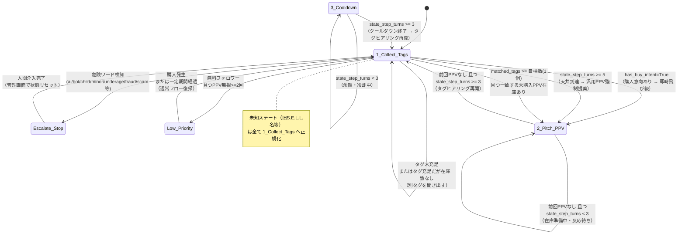

# 新ステートマシン 遷移図（Ticket 4.5 / 7.2）

## ステート一覧

| ステート | 色 | 意味 |
|----------|-----|------|
| `1_Collect_Tags` | 青 | 嗜好ヒアリング中（タグ収集） |
| `2_Pitch_PPV` | ピンク | PPV提案中 |
| `3_Cooldown` | 紫 | 余韻・冷却期間 |
| `Escalate_Stop` | 赤 | 緊急停止（人間介入待ち） |
| `Low_Priority` | グレー | 省エネモード（相槌のみ） |

## 遷移図（Mermaid）



## 判定優先順位（上から順に評価）

```
┌─────────────────────────────────────────────────────────────────┐
│  1. 危険ワード検知                                              │
│     → 該当: 即 Escalate_Stop（全ステートから）                 │
├─────────────────────────────────────────────────────────────────┤
│  2. 省エネ降格判定                                              │
│     → 無料フォロワー 且つ consecutive_ppv_ignored >= 2          │
│     → 該当: 即 Low_Priority（全ステートから）                  │
├─────────────────────────────────────────────────────────────────┤
│  3. 現在ステートに基づく遷移判定                                │
│     ├─ 1_Collect_Tags:                                         │
│     │   ├─ 例外①: has_buy_intent → 2_Pitch_PPV（即買い飛び級）│
│     │   ├─ 救済①: turns >= 5 → 2_Pitch_PPV（天井到達）        │
│     │   ├─ 通常: タグ>=目標数 且つ 在庫あり → 2_Pitch_PPV      │
│     │   └─ 維持: タグ未充足/在庫なし → 1_Collect_Tags          │
│     ├─ 2_Pitch_PPV:                                            │
│     │   ├─ 前回PPVあり → 滞在（反応待ち）                      │
│     │   └─ 前回PPVなし 且つ turns>=3 → 1_Collect_Tags（復帰）  │
│     └─ 3_Cooldown:                                             │
│         ├─ turns >= 3 → 1_Collect_Tags（復帰）                 │
│         └─ turns < 3 → 滞在（冷却中）                          │
└─────────────────────────────────────────────────────────────────┘
```

## state_step_turns の更新ルール

| 遷移 | state_step_turns |
|------|-----------------|
| 1_Collect_Tags → 1_Collect_Tags（滞在） | +1 |
| 3_Cooldown → 3_Cooldown（滞在） | +1 |
| 1_Collect_Tags → 2_Pitch_PPV | 0（リセット） |
| 2_Pitch_PPV → 1_Collect_Tags（復帰） | 0（リセット） |
| 2_Pitch_PPV → 2_Pitch_PPV（滞在） | +1 |
| 3_Cooldown → 1_Collect_Tags（復帰） | 0（リセット） |

## 設定値（system_settings テーブル参照）

| キー | デフォルト | 意味 |
|------|-----------|------|
| `tag_collect_target_count` | 1 | 目標タグ収集数 |
| `tag_collect_max_turns` | 5 | 天井往復数（救済①） |
| `cooldown_turns_threshold` | 3 | クールダウン往復数 |
| `debounce_seconds` | 18 | 受信連投デバウンス待機時間 |
